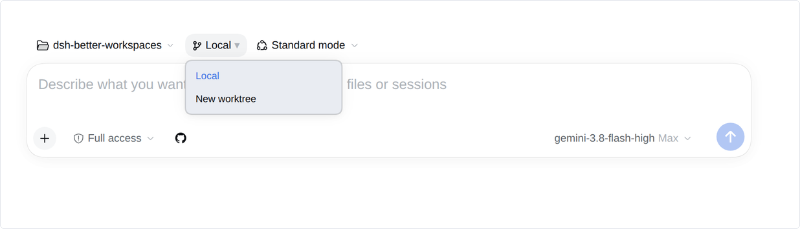
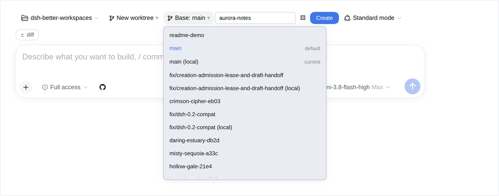
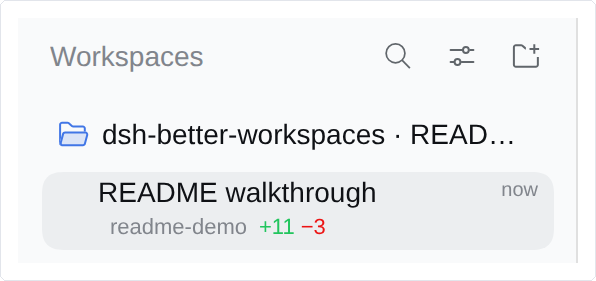
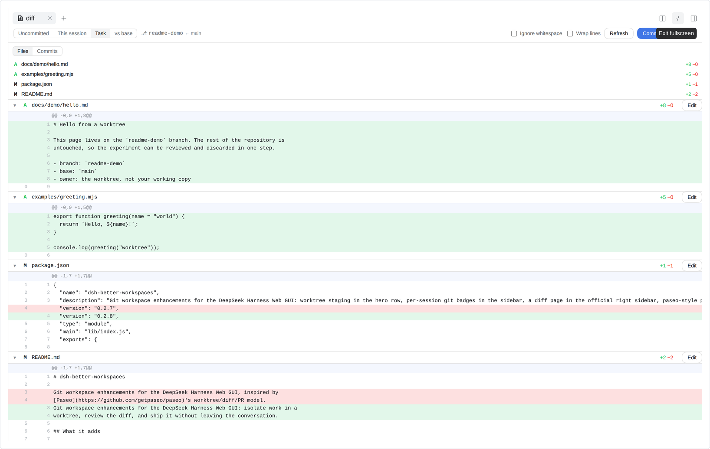
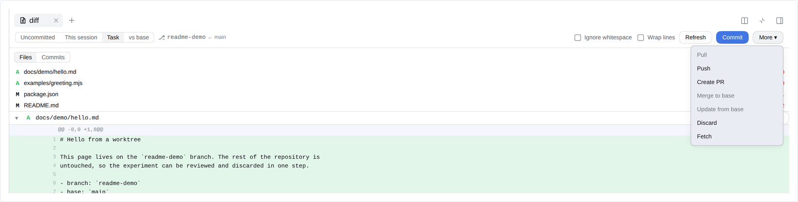
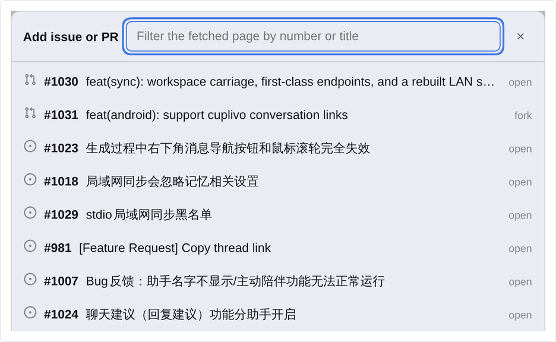
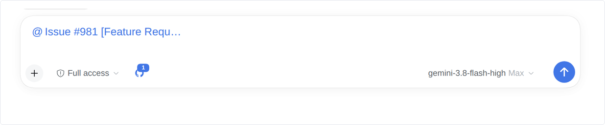

# dsh-better-workspaces

[English](README.md) · [简体中文](README.zh-CN.md) · [日本語](README.ja.md) · [Français](README.fr.md) · [한국어](README.ko.md)

在 DeepSeek Harness Web GUI 中原生集成 Git Worktree、文件差异对比、GitHub PR 与 Issue 联动。每个任务独享独立分支与隔离目录，从首条提示词到提交推送，全流程无需离开当前页面或切换终端。

---

## 功能特性

### 1. 输入框就地选择工作模式

输入框上方提供 `Local` 与 `New worktree` 快速切换。日常小修改直接在 `Local` 当前目录进行；独立功能或多任务并行时切换为 `New worktree`，自动创建专属目录与分支，彻底避免不同会话相互干扰。



### 2. 快速创建隔离工作区

输入分支名或点骰子随机生成，基线支持本地分支、远端分支或已有的 Pull Request。点击 **Create** 即可自动就绪独立的 worktree 工作区并开启关联会话。



### 3. 会话列表直观掌握 Git 状态

侧边栏会话标题下方实时呈现当前分支与改动行数（`+11 −3`）。已关联的 PR 和 CI 检查状态同步展示在同一行，无需在终端频繁输入 `git status`。



### 4. 侧边栏全功能差异评审（Diff）

点击右上角 `±` 胶囊按钮展开差异面板。支持在未提交修改、当前会话改动、任务全量改动与对比基线之间无缝切换；可逐行审阅 hunk 差异、就地编辑源码，并随时查看提交历史。



### 5. 页面内直达提交与分支操作

在差异面板中直接完成 Commit、Pull、Push、创建 PR、合并、从基线同步更新或丢弃更改。对于暂不可用的操作，面板会明确说明缺少的前置条件，避免误操作。



### 6. 一键将 GitHub PR / Issue 引入提示词

点击输入框旁的 GitHub 按钮，直接浏览并筛选当前仓库的开放 PR 和 Issue，点选后即可将其作为结构化引用加入输入框。



### 7. 紧凑的引用标签与完整上下文展开

输入框内仅展示轻巧的引用标签，不挤占编辑视线；点击发送时，标签自动展开为完整的标题、正文、分支信息及 URL，确保大模型获得精确且完整的上下文。



---

## 快速上手

1. **新建会话：** 在 DeepSeek Harness 中打开任一 Git 工作区并开启会话。
2. **选择模式：** 在输入框上方根据任务需要选择 `Local` 或 `New worktree`。
3. **开发与评审：** 通过 GitHub 按钮引用 Issue，通过侧边栏徽章跟踪进度，点击 `±` 细致评审代码改动。
4. **一键交付：** 在差异面板内直接完成提交、推送或创建 Pull Request。

---

## 安装

通过 npm 一行命令安装：

```bash
dsh plugin --profile web add @ds-hu/dsh-better-workspaces
```

安装后重启一次 `dsh --profile web` 即可生效。

也可以直接在 DSH Web 界面中安装：

1. 打开侧栏的 **插件** 页面。
2. 点击 **添加插件**。
3. 输入 `@ds-hu/dsh-better-workspaces`，安装源选择 **npm 官方源**。
4. 点击 **安装**；安装完成后点击 **立即启用**。如界面提示需要重启，请重启一次 `dsh --profile web`。

### 环境要求
- **DeepSeek Harness:** ≥ 0.2.0
- **Node.js:** ≥ 20.19
- **依赖工具:** `git`、`pnpm`（均需在 `PATH` 中可用）
- **GitHub CLI（可选）:** 若配置了已登录的 `gh`，可使用 PR 与 Issue 快速检索和引用功能；未安装时，Worktree、侧边栏徽章和差异评审等全部核心功能均可正常使用。

---

## 说明

- 兼容 Linux、macOS 13+ 及 Windows 10+。
- 所有流程均在当前浏览器标签页内完成，无需额外开启客户端或切换应用。

---

## 文档

- [docs/TECHNICAL.md](docs/TECHNICAL.md) — 架构解析、安全边界、升级说明与手动维护操作。
- [docs/adr/](docs/adr/) — 详细架构决策记录（ADR）。

---

## 许可证

[MIT](LICENSE)。第三方组件声明见 [NOTICE](NOTICE) 与 [LICENSES/](LICENSES/)。
